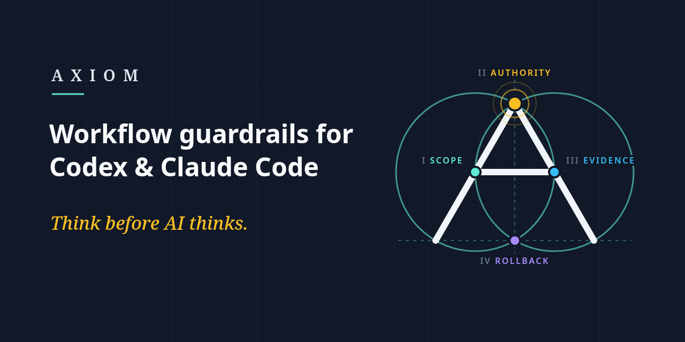
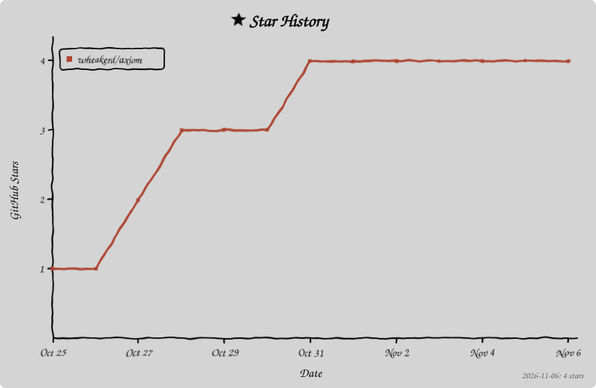

<div align="center">

# Axiom

**Think before AI thinks.**

English | [简体中文](README.zh-CN.md)

<!-- readme:badges:start -->
[](https://github.com/wheakerd/axiom/releases/latest) [](plugin/skills) [](docs/en/compatibility.md) [](LICENSE)
<!-- readme:badges:end -->

[](https://github.com/wheakerd/axiom/actions/workflows/unit-and-integration-tests.yml) [](https://github.com/wheakerd/axiom/actions/workflows/hook-runtime-integration.yml) [](https://github.com/wheakerd/axiom/actions/workflows/distribution-drift.yml) [](https://github.com/wheakerd/axiom/actions/workflows/codeql.yml)

Focused workflow skills for Codex and Claude Code that turn requests into clear, actionable work.

[Install](#installation) | [Update](#updating) | [Use](#usage) | [Skills](#skills) | [Documentation](docs/en/README.md) | [Changelog](CHANGELOG.md)



If Axiom helps your agent work, consider starring the repository. Stars help other Codex and Claude Code users find it.

[](https://github.com/wheakerd/axiom/stargazers)

</div>

---

## Skills

Describe the outcome you want, or name a skill. Axiom selects a bundled skill from your host's skill list by its description; a request that matches none continues through the host as usual. Skills use the host's existing tools and permissions, with no background service or automatic updater.

<!-- readme:skill-index:start -->
| Skill | What it does |
| --- | --- |
| [`using-axiom`](plugin/skills/using-axiom/SKILL.md) | Route installed Axiom skills from a session bootstrap |
| [`clarify-intent`](plugin/skills/clarify-intent/SKILL.md) | Resolve unclear requests with options or a custom answer |
| [`delegate-simple-task`](plugin/skills/delegate-simple-task/SKILL.md) | Delegate simple work to your ordered candidate models |
| [`task-planning`](plugin/skills/task-planning/SKILL.md) | Create and revise plans around current requirements |
| [`continuous-progress`](plugin/skills/continuous-progress/SKILL.md) | Supervised progress on a native scheduler |
| [`local-web-search`](plugin/skills/local-web-search/SKILL.md) | Constrain local searches and stop at site challenges |
| [`agents-architect`](plugin/skills/agents-architect/SKILL.md) | Initialize, maintain, and validate scoped AGENTS.md systems |
| [`agent-plugin-architect`](plugin/skills/agent-plugin-architect/SKILL.md) | Design and audit packaged plugin architecture |
| [`optimize-agent-usage`](plugin/skills/optimize-agent-usage/SKILL.md) | Reduce agent context and workflow overhead |
| [`review-axiom-task`](plugin/skills/review-axiom-task/SKILL.md) | Audit Axiom decisions from observable evidence |
| [`verify-completion`](plugin/skills/verify-completion/SKILL.md) | Check completion claims against current evidence |
| [`confirm-external-action`](plugin/skills/confirm-external-action/SKILL.md) | Bind and verify consequential external actions |
| [`traceable-git-submit`](plugin/skills/traceable-git-submit/SKILL.md) | Trace checkpoints and explicit Git submissions |
| [`reversible-system-change`](plugin/skills/reversible-system-change/SKILL.md) | Plan and verify reversible system changes |
<!-- readme:skill-index:end -->

Each skill's `SKILL.md` describes it in full; [Examples](docs/en/examples.md) shows requests and expected behavior.

## Installation

Run these commands in a terminal for your host.

**Codex:**

```bash
codex plugin marketplace add wheakerd/axiom --sparse .agents/plugins
codex plugin add axiom@axiom
```

**Claude Code:**

```bash
claude plugin marketplace add wheakerd/axiom
claude plugin install axiom@axiom
```

Each marketplace selects an immutable published version. A new version reaches both marketplaces only after its release is published and verified; development commits on `main` do not advance that selection.

In Codex, start a new session and trust the Hook in `/hooks`: Codex skips a new or changed Hook until you do, and Axiom's routing begins after that step. Claude Code has no separate Hook trust step and runs the Hook at the next `SessionStart` after the plugin loads. On Windows, Claude Code needs Git Bash for the Hook, and neither host has a recorded Windows observation yet; see [Compatibility](docs/en/compatibility.md#current-bounded-status). Verifying an installed Hook against its checked-in definition is an optional reviewer step described in the [Trust Model](docs/en/trust-model.md#hook-trust-boundary). The [Getting Started guide](docs/en/guides/getting-started.md) owns the full installation and first-use procedure.

## Updating

Refresh the installed marketplace snapshot from a terminal.

**Codex:**

```bash
codex plugin marketplace upgrade axiom
```

**Claude Code:**

```bash
claude plugin marketplace update axiom
claude plugin update axiom@axiom
```

After updating, start a new session; Codex holds the changed Hook until you trust it again in `/hooks`. Automatic update behavior is controlled by each host and your settings. See [Managing an Installation](docs/en/guides/managing-installation.md) for in-app updates, disabling, removal, and troubleshooting. For a marketplace clone timeout in either host, follow the guide's [recovery procedure](docs/en/guides/managing-installation.md#marketplace-clone-timeouts).

## Usage

To name a skill, include `$skill-name` in Codex or type `/axiom:skill-name` in Claude Code. Try a read-only request that matches a skill:

```text
Use the agents-architect skill to audit this repository's AGENTS.md
instruction system. Report findings only; do not modify files.
```

Then try an ordinary request:

```text
Summarize the purpose of this README. Do not modify files.
```

The first request should select `agents-architect` and say so in one line, `axiom:agents-architect` with a brief reason, as the gate's [invocation notes](plugin/skills/using-axiom/SKILL.md#invocation-notes) describe; the second should continue normally without another skill and without a notice. These are expected behaviors, not a claim that your installation has already reproduced them.

> [!IMPORTANT]
> A request that matches no Axiom skill still follows your host's permissions and repository instructions. No match is not a safety certification. Selecting a skill does not grant permission to edit, publish, deploy, or delete anything.

[Examples](docs/en/examples.md) shows more requests and their expected behavior.

## Star History



The [Record star history workflow](.github/workflows/record-star-history.yml) re-renders the chart daily from [`stars.csv` on the `stats` branch](https://github.com/wheakerd/axiom/blob/stats/stars.csv); see the [stats branch policy](docs/en/repository-governance.md#stats-branch-policy).

## Documentation and Support

- [Documentation index](docs/en/README.md): guides and references by task.
- [Latest release](https://github.com/wheakerd/axiom/releases/latest) and [Changelog](CHANGELOG.md): what changed in each version and any required action.
- [Compatibility](docs/en/compatibility.md): supported hosts and known limitations.
- [Trust Model](docs/en/trust-model.md): security boundaries. Axiom is a public beta; its instructions do not replace host permissions or provide a sandbox.
- [GitHub Discussions](https://github.com/wheakerd/axiom/discussions): questions and early ideas.
- [GitHub Issues](https://github.com/wheakerd/axiom/issues/new/choose): bug reports, feature requests, routing cases, and compatibility reports.
- [SECURITY.md](SECURITY.md): report a vulnerability privately.
- [Contributing](CONTRIBUTING.md) and [Code of Conduct](CODE_OF_CONDUCT.md): contribution guidance and community expectations.

## License

[MIT](LICENSE).
