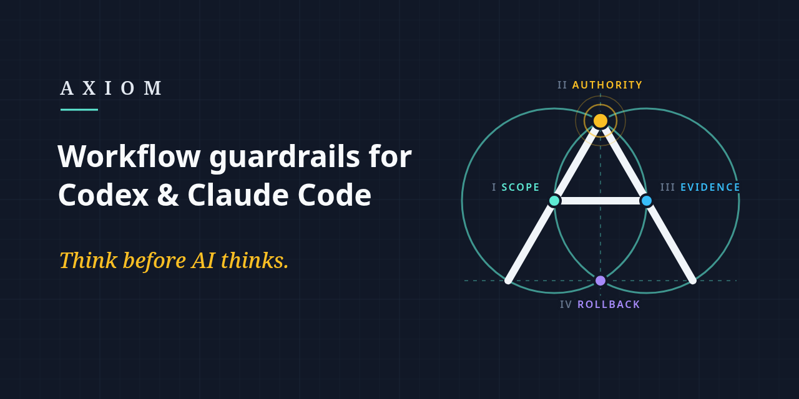
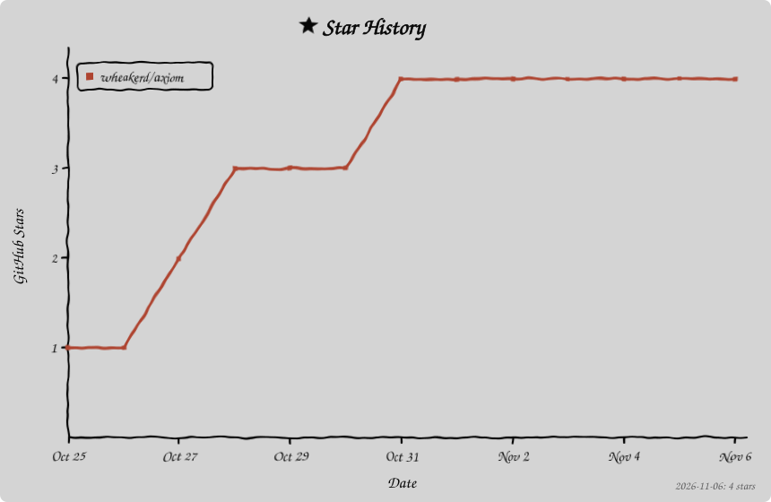

<div align="center">

# Axiom

**Think before AI thinks.**

[English](README.md) | 简体中文

<!-- readme:badges:start -->
[](https://github.com/wheakerd/axiom/releases/latest) [](plugin/skills) [](docs/en/compatibility.md) [](LICENSE)
<!-- readme:badges:end -->

[](https://github.com/wheakerd/axiom/actions/workflows/unit-and-integration-tests.yml) [](https://github.com/wheakerd/axiom/actions/workflows/hook-runtime-integration.yml) [](https://github.com/wheakerd/axiom/actions/workflows/distribution-drift.yml) [](https://github.com/wheakerd/axiom/actions/workflows/codeql.yml)

面向 Codex 与 Claude Code 的专注型工作流技能，把请求转化为清晰、可执行的工作。

[安装](#安装) | [更新](#更新) | [用法](#用法) | [技能](#技能) | [文档](docs/zh-CN/README.md) | [版本发布](https://github.com/wheakerd/axiom/releases)



如果 Axiom 对你的智能体工作有帮助，欢迎为仓库加星。星标能帮助其他 Codex 与 Claude Code 用户发现它。

[](https://github.com/wheakerd/axiom/stargazers)

</div>

---

## 技能

描述你想要的结果，或直接点名一个技能。Axiom 依据描述从宿主的技能列表中选择一个捆绑技能；不匹配任何技能的请求照常由宿主继续处理。技能使用宿主现有的工具与权限，没有后台服务，也没有自动更新器。

<!-- readme:skill-index:start -->
| Skill | What it does |
| --- | --- |
| [`using-axiom`](plugin/skills/using-axiom/SKILL.md) | Route installed Axiom skills from a session bootstrap |
| [`clarify-intent`](plugin/skills/clarify-intent/SKILL.md) | Resolve unclear requests with options or a custom answer |
| [`delegate-simple-task`](plugin/skills/delegate-simple-task/SKILL.md) | Delegate simple work to your ordered candidate models |
| [`task-planning`](plugin/skills/task-planning/SKILL.md) | Create and revise plans around current requirements |
| [`continuous-progress`](plugin/skills/continuous-progress/SKILL.md) | Supervised progress on a native scheduler |
| [`local-web-search`](plugin/skills/local-web-search/SKILL.md) | Constrain local searches and stop at site challenges |
| [`agents-architect`](plugin/skills/agents-architect/SKILL.md) | Initialize, maintain, and validate scoped AGENTS.md systems |
| [`agent-plugin-architect`](plugin/skills/agent-plugin-architect/SKILL.md) | Design and audit packaged plugin architecture |
| [`optimize-agent-usage`](plugin/skills/optimize-agent-usage/SKILL.md) | Reduce agent context and workflow overhead |
| [`review-axiom-task`](plugin/skills/review-axiom-task/SKILL.md) | Audit Axiom decisions from observable evidence |
| [`verify-completion`](plugin/skills/verify-completion/SKILL.md) | Check completion claims against current evidence |
| [`confirm-external-action`](plugin/skills/confirm-external-action/SKILL.md) | Bind and verify consequential external actions |
| [`traceable-git-submit`](plugin/skills/traceable-git-submit/SKILL.md) | Trace checkpoints and explicit Git submissions |
| [`reversible-system-change`](plugin/skills/reversible-system-change/SKILL.md) | Plan and verify reversible system changes |
<!-- readme:skill-index:end -->

每个技能的 `SKILL.md` 完整描述该技能；[示例](docs/en/examples.md)展示请求与预期行为。

## 安装

在终端中运行对应宿主的命令。

**Codex：**

```bash
codex plugin marketplace add wheakerd/axiom --sparse .agents/plugins
codex plugin add axiom@axiom
```

**Claude Code：**

```bash
claude plugin marketplace add wheakerd/axiom
claude plugin install axiom@axiom
```

两个市场都选定 `release` 分支，该分支只包含已发布的版本：发布某个版本时由 CI 把它加入该分支，`main` 上的开发提交永远不会进入它。

在 Codex 中，开启新会话并在 `/hooks` 中信任该 Hook：Codex 会跳过新的或已更改的 Hook，直到你信任它，Axiom 的路由在这一步之后才开始。Claude Code 没有单独的 Hook 信任步骤，会在插件加载后的下一次 `SessionStart` 运行该 Hook。在 Windows 上，Claude Code 运行 Hook 需要 Git Bash，而且两个宿主目前都没有 Windows 观测记录；见[兼容性](docs/en/compatibility.md#current-bounded-status)。将已安装的 Hook 与其签入定义进行比对，是审阅者的可选步骤，见[信任模型](docs/zh-CN/trust-model.md#hook-信任边界)。完整的安装与首次使用流程由[快速开始指南](docs/zh-CN/guides/getting-started.md)负责。

## 更新

在终端中刷新已安装的市场快照。

**Codex：**

```bash
codex plugin marketplace upgrade axiom
```

**Claude Code：**

```bash
claude plugin marketplace update axiom
claude plugin update axiom@axiom
```

更新后请开启新会话；Codex 会保留已更改的 Hook，直到你在 `/hooks` 中再次信任它。自动更新行为由各宿主及你的设置控制。应用内更新、禁用、移除与排障见[管理安装](docs/zh-CN/guides/managing-installation.md)。任一宿主出现市场克隆超时时，按该指南的[恢复流程](docs/zh-CN/guides/managing-installation.md#市场克隆超时)处理。

## 用法

要点名一个技能，在 Codex 中写入 `$skill-name`，或在 Claude Code 中输入 `/axiom:skill-name`。先试一个与某个技能匹配的只读请求：

```text
Use the agents-architect skill to audit this repository's AGENTS.md
instruction system. Report findings only; do not modify files.
```

再试一个普通请求：

```text
Summarize the purpose of this README. Do not modify files.
```

第一个请求应选中 `agents-architect`，并按门控的[调用说明](plugin/skills/using-axiom/SKILL.md#invocation-notes)用一行 `axiom:agents-architect` 加简短原因来说明；第二个请求应照常继续，不选中其他技能，也不给出通知。这些是预期行为，并不表示你的安装已经复现了它们。

> [!IMPORTANT]
> 不匹配任何 Axiom 技能的请求仍然遵循宿主的权限和仓库指令。不匹配不是安全认证。选中一个技能并不授予编辑、发布、部署或删除任何内容的权限。

[示例](docs/zh-CN/examples.md)展示了更多请求及其预期行为。

## Star 历史



[记录 Star 历史的工作流](.github/workflows/record-star-history.yml)每天根据 [`stats` 分支上的 `stars.csv`](https://github.com/wheakerd/axiom/blob/stats/stars.csv) 重新渲染图表；见 [stats 分支策略](docs/en/repository-governance.md#stats-branch-policy)。

## 文档与支持

- [文档索引](docs/zh-CN/README.md)：按任务组织的指南与参考。
- [最新 Release](https://github.com/wheakerd/axiom/releases/latest) 与[全部 Releases](https://github.com/wheakerd/axiom/releases)：每个版本的变更以及需要的操作。
- [兼容性](docs/en/compatibility.md)：支持的宿主与已知限制。
- [信任模型](docs/zh-CN/trust-model.md)：安全边界。Axiom 处于公开测试阶段；它的指令不替代宿主权限，也不提供沙箱。
- [GitHub Discussions](https://github.com/wheakerd/axiom/discussions)：提问与早期想法。
- [GitHub Issues](https://github.com/wheakerd/axiom/issues/new/choose)：缺陷报告、功能请求、路由用例与兼容性报告。
- [SECURITY.md](SECURITY.md)：私下报告漏洞。
- [贡献指南](CONTRIBUTING.md)与[行为准则](CODE_OF_CONDUCT.md)：贡献指引与社区期望。

## 许可证

[MIT](LICENSE)。
